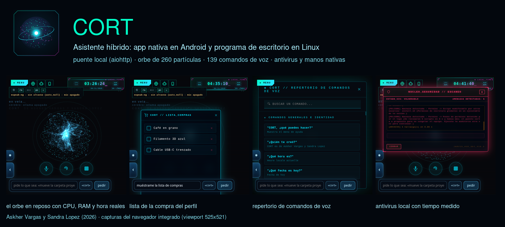
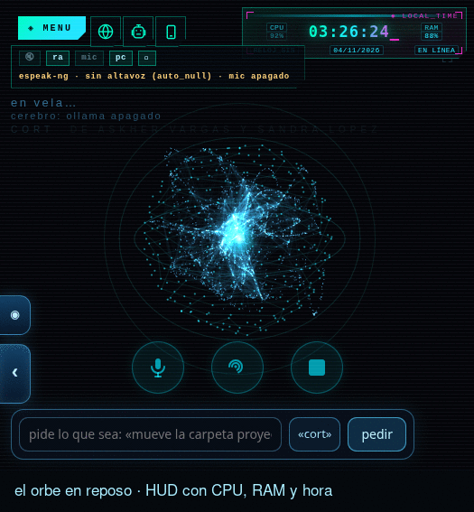

# CORT — Cognitiva · Omnipresente · Rapsodia · Terminal



Asistente local, privado y con voz. **No es una página web: es una app híbrida con
dos instaladores distintos.** En el teléfono es una APK nativa (`dev.sandra.cort.movil`,
Java + WebView + grabación de audio propia) y en el equipo es un programa de escritorio
que corre el puente Python y abre la interfaz en el navegador del sistema. Los dos
frentes comparten el mismo puente y el mismo perfil. Nada de CORT sale del equipo: el puente es
un proceso Python en `127.0.0.1`, la interfaz la sirve ese mismo proceso y las respuestas
se deciden con reglas locales y con los sensores y mandos reales del equipo.



Las dos imágenes son capturas reales tomadas en el navegador integrado (viewport
525×521 medido en esta máquina); ningún píxel de interfaz está generado por IA. La
marca es el orbe de la interfaz vectorizado: 140 puntos sobre una esfera con la
inclinación de eje que se ve en pantalla, núcleo blanco-cian y dos órbitas, con la
paleta de `cort-style.css` (menta `#00ffc8`, cian `#22e5ff`, magenta `#ff2bd6`).
El mismo generador de puntos produce el icono adaptativo de Android
(`apps/android/res/mipmap-anydpi-v26/ic_cort.xml`), así la marca del teléfono y la del
escritorio no son dos dibujos distintos.


**Autoría y derechos: Askher Vargas y Sandra Lopez (2026).** Soporte y permisos:
`Sandrasofialopezgomez3@gmail.com` · `Carlosa3325@gmail.com`.

Licencia de atribución con no monetización (ver `LICENSE` y `AVISO_LEGAL.md`): se
puede usar, estudiar y modificar libremente, pero **no se puede vender ni monetizar
sin dar la autoría y sin escribir antes a esos correos**.

Referencias de estilo, no dueñas de CORT: la maqueta de JARVIS de TechEnClair sirvió
de andamio de plantilla y se rediseñó; la estética holográfica de Cortana (Halo) es
sólo inspiración visual. Ver `cort-web/PROCEDENCIA.md`.

---

## Qué hace, con lo que se pudo medir

| Función | Estado | Cómo se verificó |
|---|---|---|
| Puente local con protocolo JSON sobre WebSocket | real | `cort-bridge/cort_server.py`, un solo escritor por conexión |
| Hablar en voz alta | real | espeak-ng (factor 0,14 ms de CPU por s de audio) y Piper es_ES (1,90 / 2,55) |
| Escuchar (STT local) | real con WAV | Vosk `vosk-model-small-es-0.42`: transcribe 3,9 s de audio en 7,0 s |
| Micrófono en la Classmate | **no hay hardware** | `pactl list short sources` sólo muestra `auto_null.monitor` |
| Altavoz en la Classmate | **no hay hardware** | sólo `auto_null`; con un sink nulo temporal el audio salió (RMS 2521) |
| Abrir/cerrar aplicaciones, ventanas, volumen, brillo, captura, notificaciones | real | 12 acciones en `cort-bridge/cort_acciones.py`, probadas en el equipo |
| Cerebro con Ollama | real pero limitado | 6 modelos en disco; el más ligero pide ~511 MB y hay 227–266 MB libres |
| Reglas locales (hora, fecha, clima, temperatura, estado del equipo) | real | `/proc`, open-meteo y sensores del kernel |
| Auditoría de seguridad | real, informa y no borra | arranque, procesos, archivos y permisos |
| Vida diaria: lista de compras, notas, recordatorios, temporizadores, «léeme la selección» | real | `cort-bridge/cort_vida.py`; 0,34 s de frase a respuesta y temporizador de 5,00 s disparado a los 5,52 s |
| Núcleo con reja: frase → plan JSON → validar → ejecutar → verificar | real | `cort-bridge/cort_intenciones.py`; 18/18 en `prueba_intenciones.py` y 6+12 en `prueba_nucleo.py`, siempre en arena (`CORT_HOME=/tmp`) |
| Bajar y probar modelos Ollama desde la pantalla | real | panel `#cort-cerebro`: pesos medidos en disco, RAM estimada, `descargar` con progreso y `probar el cerebro` con latencia medida |
| Sonda automática del cerebro | real, disparada por la RAM | `auto_sonda()` mide el modelo en cuanto hay RAM libre y escribe `mediciones/medicion-cerebro.json`; 11/11 en `prueba_sonda.py` con Ollama falso |
| Palabra de despertar («cort») | real la lógica, pendiente de micro | `filtro_wake()` 11/11 en `prueba_wake.py`; ventana de 8 s y variantes acústicas cubiertas |
| Canal de actualización desde el repo | real | `cort-bridge/cort_actualiza.py`; 7/7 en `prueba_actualiza.py`. Avisa y da el comando, **no se autoinstala** |
| Escáner de capacidades (el equipo se adapta solo) | real medido | `cort-bridge/cort_perfil.py`; 14/14 en `prueba_perfil.py`. En esta laptop: nivel 0, `AVX no`, 397 ms de ida y vuelta por WebSocket y la interfaz bajando a 30 fps con las scanlines apagadas |
| Gestos con cámara → mover ventanas | real medido | `cort-bridge/cort_vision.py`; 12/12 en `prueba_vision.py` y 7/7 en `cort_vision.py selftest`. Webcam real: YUY2 320×240 a **15 cuadros/s**, **1,9–4,6 ms** de cálculo por cuadro, worker de 33,7 MB y **ninguna imagen guardada**. Una persona sentada quieta dispara **0 gestos** (era 8 cada 8 s antes de cerrar el umbral de movimiento) |
| Mapa propio (Leaflet + OSM) | **aparcado (F6)** | recortable por acuerdo; no se finge un mapa |
| Idiomas: español por defecto sobre una interfaz que nació en francés | real medido | capa `cort-web/cort/cort-ui.js`: 958 triples `[fr, es, en]` más reglas para los rótulos que llevan datos dinámicos. Con todos los paneles abiertos, `window.CORT.estado()` mide 1804 cadenas vistas, 644 reconocidas como francesas, 644 traducidas y 0 pendientes. Antes el medidor presumía «100 %» contando sólo 504: el clasificador no conocía el francés sin tilde (`SYSTEME`, `MINUTEUR`, `CHARGEMENT`, `CAMÉRA`). Arreglado, salieron 59 cadenas reales que se tradujeron; 33 casos de prueba del clasificador, 0 falsos positivos con palabras españolas de la misma grafía (`tres`, `video`, `micro`, `agenda`, `carte`) |
| Carisma, memoria escrita y autocorrección | real medido | `cort-bridge/cort_memoria.py`; 23/23 en `prueba_memoria.py` y 16/16 en su `selftest`. Ciclo memoria→prompt→revisión en **1,56–3,21 ms por frase**; constitución de **786 caracteres** dentro del `system`; **0 entrenamientos de pesos** (sin AVX y con ~200 MB libres no cabe) — CORT aprende escribiendo, y lo que guarda se ve en `memoria.json` con su camino completo |
| ¿Habría que escribir partes en C o Rust? | decidido con medida | `mediciones/s5-medida.sh`: un ayudante C de X11 (16 KB, compila en **826 ms**) gana **8–12 ms por orden** a `wmctrl`, que es ~2 % del trayecto de una orden. Rust **sí está instalado** (`rustc 1.98.1`) y su bucle corre 8 veces más rápido que Python, pero **tarda 33,5 s en compilar** tres líneas en esta laptop. No entra ninguno en el release; Java/Kotlin sólo en el APK |
| PWA instalable (el teléfono) | real medido | service worker `activated` y `cort-v1` con las 9 piezas del programa; `CORT_BIND`/`CORT_TLS` para HTTPS en LAN |
| **APK nativo para el teléfono** | real medido y **publicado**: `cort-v0.15.1` (la release la crea el propio runner) | `apps/android` es **CORT nativo** (28 clases Java, 8 622 líneas más 452 de C++: orbe, cara, cerebro de 33 reglas, 15 manos locales, SQLite, traje de asistente, el parlamento que habla con la PC, el lector que te lee en cualquier app, el sensor de audífonos y el almacén de cerebros GGUF) **con el oído dentro**: Vosk 0.3.75 + JNA + el modelo español de 39,8 MB viajan en el APK, descargados en el pipeline con su SHA-256 fijado en `apps/android/deps.txt` y acreditados pieza por pieza en `apps/android/ACREDITACION.md`. Sin Gradle ni AndroidX: el mismo método de siempre (`aapt2` → `javac --release 11` → `d8` → `zip -0` → `zipalign -p` → `apksigner`) en `.github/workflows/apk-movil.yml`. **Medido en la release `cort-v0.15.1`** (`0.15.1`, `versionCode 1501`, run 41977159844): **59 581 673 bytes = 56,82 MB**, con su SHA-256 (`03b001bd…4741`) en el archivo `CORT-movil.apk.sha256` de la propia release, 17 entradas, `classes.dex` de 798 160 B (aquí entraron zxing y las pantallas nuevas), `libvosk.so` de 10 042 800 B (arm64) y 8 985 628 B (v7a), las `.so` y `resources.arsc` **sin comprimir y alineadas a página** (`extractNativeLibs="false"` lo exige), firmado **con la llave del repo** (`faabef46…1977`, la misma de `cort-v0.11.0`: se instala encima). **U1, el cerebro que se baja** (está en el código de la rama, todavía no en la release publicada):
`libcortmotor.so` — llama.cpp b12121 con el NDK r26d, enlazado estático y autocontenido en
`.github/workflows/motor-local.yml`, 177 s de runner para las dos ABIs — más
`CerebroLocal.java`/`Cerebros.java`, que ofrecen tres Qwen2.5 GGUF en
`apps/android/assets/cerebros.json` (491 400 032, 752 880 160 y 1 117 320 736 bytes, pesos y
SHA-256 medidos el 2026-11-05 en Hugging Face), los descargan al carbajo de la app con `Range`
y comprueban la suma entera antes de fiarse. Ningún GGUF viaja en el APK. La ruta es Automático
(el teléfono si cabe en la RAM libre, con la puerta del doble del archivo) · Teléfono · PC o
nube, y las 33 reglas siguen delante.Antes pesaba **16 873 bytes** porque era una carcasa: la ×3 530 es el oído, no el código. Falta su prueba física en el A16 (carga del modelo, RAM y latencia real del dictado). El camino viejo sigue medido: `POST /mic` **7/7** en `scripts/prueba_mic_telefono.py` (2,82 s con el modelo en RAM en la Classmate) |
| Censo de las 29 órdenes de lectura | real medido | `scripts/inventario_funciones.py` contra el puente instalado: **28 de 29 contestan con `origen: real`**; la que no es `get_winget_upgrades`, que en arena contesta en 7,6 s y aquí se pasa de 20 s con el equipo al 98 % de CPU. Tabla completa en `INFORME_FUNCIONES.md` §15 |

Cada mensaje del puente lleva `origen`: `"real"` o `"no disponible"`. Si algo no se
puede, CORT lo dice con el motivo y con el número que falta — no simula.

---

## Arquitectura

```
cort-bridge/            proceso único, dos puertos
  cort_server.py        8766 HTTP (interfaz) + 8765 WebSocket (protocolo JSON)
  cort_intenciones.py   la reja del núcleo: verbos y raíces permitidos, confirmación humana
  cort_voz.py           voz de salida (espeak-ng / Piper) y escucha (Vosk)
  cort_acciones.py      manos en Linux: wmctrl, pactl, xdotool, scrot, xclip, apt, dpkg
  cort_archivos.py      mover/copiar/renombrar con verificación después
  cort_vida.py          compras, notas, pendientes, temporizadores, selección leída
  cort_actualiza.py     lee las etiquetas del repo y avisa; no descarga ni cambia nada
  cort_perfil.py        escanea el equipo (CPU/AVX, RAM, GPU, cámara, temperatura) y decide
                        el nivel de cerebro y qué se apaga para que lo demás quepa
  cort_vision.py        la mirada: lee la webcam cuadro a cuadro, saca piel+movimiento y
                        traduce cuatro gestos en órdenes de ventana (nada se guarda)
  cort_memoria.py       la persona: constitución, memoria escrita en disco, autocorrección
                        antes de hablar e iniciativa al conectar (nunca reentrena pesos)
  cort_state.json       preferencias personales (ignoradas por git; CORT_STATE elige la ruta)
cort-web/
  index.html            la interfaz (rediseñada sobre la plantilla)
  cort/cort-mock.js     enlace con el puente; lo que no hay puente se simula y se dice
  cort/cort-orbe.js     capa de partículas del orbe (medida, no decorada)
  cort/cort-ui.js       idioma español, avisos honestos, testigo de voz, bandeja de tirador,
                        panel del cerebro y aviso de versión
  cort/cort-style.css   recorte HUD, paneles y testigos
scripts/                pruebas: prueba_intenciones · prueba_nucleo · prueba_sonda ·
                        prueba_wake · prueba_actualiza · prueba_perfil · prueba_vida ·
                        prueba_voz · prueba_acciones · prueba_vision · prueba_memoria ·
                        prueba_mic_telefono · inventario_funciones ·
                        instala_cort · arranca_cort · para_cort · desinstala_cort ·
                        arranca_con_sonda.sh
apps/android/           CORT nativo del teléfono (orbe, cerebro, manos, SQLite y oído Vosk)
apps/android/deps.txt   qué se baja para el oído, con su URL y su SHA-256
apps/android/ACREDITACION.md  licencias pieza por pieza y qué NO va dentro del APK
docs/ANDROID.md         cómo se compila el APK, cómo se instala y qué no hace todavía
requirements-cort.txt   lo mínimo que necesita el puente, con las versiones medidas
PLAN_NUCLEO.md          las cinco capas del núcleo y lo medido fase por fase (F9…S4)
PLAN_MOVIL.md           el plan del teléfono: cerebro local, integración en el sistema y las fases U1–U4
PLAN_FASES.md           las fases F1–F8 con lo cerrado y lo pendiente
INFORME_FUNCIONES.md    censo de las 34 órdenes de lectura de la plantilla
```

El núcleo son cinco capas y ninguna puede saltarse a la siguiente:

```
oído (Vosk / bandeja escrita)
  → compilador (Ollama con format:"json", temperature:0, num_ctx:2048)
    → reja (lista blanca de verbos y raíces; si duda, pide confirmación humana)
      → ejecutor (argumentos, nunca shell)
        → verificador (mide el resultado y lo cuenta con origen real o "no disponible")
```

La regla que sostiene todo: **el modelo nunca toca el disco, la red ni el teléfono.**
Propone un JSON; decide la reja.

Un navegador habla con el puente por `ws://127.0.0.1:8765/ws`. El puente nunca usa
`shell=True`: ejecuta listas de argumentos y compara lo que le piden contra lo que
existe en el equipo (ventanas abiertas, entradas `.desktop`).

---

## Instalación en Linux (MX Linux / XFCE, probado en una Classmate con 2 núcleos y 1851 MB)

### En un paso

```bash
cd CORT && ./scripts/instala_cort.sh
```

Hace, y lo dice en la pantalla, exactamente esto: comprueba `python3` y `venv` (si faltan,
pide tu consentimiento con los paquetes exactos delante y **no ejecuta sudo por ti**), crea
`.venv`, instala sólo lo declarado en `requirements-cort.txt`, escribe el lanzador de menú
`~/.local/share/applications/cort.desktop` y su arranque automático de XFCE, y si el equipo
tiene instancia de usuario de systemd escribe y activa `~/.config/systemd/user/cort.service`.

Medido en esta laptop: **MX Linux 13 + XFCE no trae user manager de systemd**
(`/run/user/1000/bus` no existe y `systemctl --user` falla con «Failed to connect to user
scope bus»). El instalador lo comprueba, lo dice, y deja el arranque automático de XFCE, que
sí funciona aquí. Donde sí hay systemd (Debian y Ubuntu de hoy) queda el servicio.

Opciones: `--red` abre el puente a la red local para usarlo desde el teléfono,
`--sin-autostart` no pone el arranque automático, `--sin-pregunta` corre sin preguntas para
documentos o CI. Al final `scripts/para_cort.sh` apaga, `scripts/desinstala_cort.sh` quita lo
instalado **sin tocar tus datos**, y `scripts/arranca_cort.sh` es lo que llama el lanzador.

### Paso a paso, si prefieres verlo

1. Copiar el repo y entrar en él:

   ```bash
   cd CORT
   ```

2. Crear el entorno con las dependencias de voz y del puente:

   ```bash
   python3 -m venv .venv
   .venv/bin/pip install aiohttp vosk piper-tts
   ```

3. Bajar los modelos (fuera del repo, en `~/.local/share/cort`):

   ```bash
   mkdir -p ~/.local/share/cort/voz ~/.local/share/cort/modelos
   # voz natural (opcional; espeak-ng ya viene con el sistema y es el motor por defecto)
   curl -sL -o ~/.local/share/cort/voz/es_ES-mls_10246-low.onnx \
     https://huggingface.co/rhasspy/piper-voices/resolve/main/es/es_ES/mls/low/es_ES-mls_10246-low.onnx
   curl -sL -o ~/.local/share/cort/voz/es_ES-mls_10246-low.onnx.json \
     https://huggingface.co/rhasspy/piper-voices/resolve/main/es/es_ES/mls/low/es_ES-mls_10246-low.onnx.json
   # escuchar (Vosk, 58 MB)
   curl -sL -o /tmp/vosk-es.zip https://alphacephei.com/vosk/models/vosk-model-small-es-0.42.zip
   unzip -q /tmp/vosk-es.zip -d ~/.local/share/cort/modelos/
   mv ~/.local/share/cort/modelos/vosk-model-small-es-0.42 ~/.local/share/cort/modelos/vosk-es
   ```

4. Arrancar:

   ```bash
   .venv/bin/python -u cort-bridge/cort_server.py
   ```

   Abrir <http://127.0.0.1:8766/index.html>.

5. Comprobar qué ve el equipo, sin tocar nada:

   ```bash
   .venv/bin/python cort-bridge/cort_voz.py estado
   .venv/bin/python cort-bridge/cort_acciones.py estado
   ```

6. Cerebro local (opcional, y sólo cuando la máquina respire):

   Ollama se instala desde su página oficial, **descargando el instalador y leyéndolo
   antes de ejecutarlo** (no se corre `curl … | sh` a ciegas). En MX Linux vale el
   paquete `.deb` para amd64 de esa página, o el tarball: se descomprime en
   `/usr/local/bin` y se arranca con `ollama serve`.

   Con el puente corriendo, abrir el panel **◉** de la interfaz: lista los modelos que
   hay en disco con su peso medido y cuánta RAM pedirían, deja **descargar** los que
   faltan y **probar el cerebro** con una frase. Si la cuenta no cabe, no lo carga y
   dice la cifra en vez de congelar el equipo.

### Qué guarda CORT de ti, dónde, y cómo borrarlo

Todo son archivos de texto en `~/.local/share/cort/` (`CORT_DATOS`). Se pueden abrir con
cualquier editor y borrar sin desinstalar nada:

| Archivo | Qué hay dentro | Cómo se llena |
|---|---|---|
| `memoria.json` | `preferencias` (nombre, ciudad, tono, gustos), `hechos` (lo que pediste recordar), `correcciones` (lo que no quieres que diga), `avisos` (cuándo habló por última vez por su cuenta) | diciendo «recuerda que…», «llámame…», «no me digas X, dime Y» |
| `constitucion.md` | los 7 principios que viajan en el `system` de cada frase | se edita a mano; si tiene más de 40 caracteres, CORT usa este y no el de fábrica |
| `cort_state.json` | modelo elegido y preferencias del puente | desde el panel ◉ o la consola |
| `vida/` | lista de compras, notas y pendientes con fecha | «anota que…», «pon como pendiente… para el…» |

Borrar la memoria es literalmente borrar el archivo, y CORT deja de saber esas cosas:

```bash
cp ~/.local/share/cort/memoria.json ~/memoria-cort-respaldo.json && rm ~/.local/share/cort/memoria.json
```

No entra audio ni imagen: los cuadros de la cámara se tiran después de sacar cuatro números
(fase S2), y a `memoria.json` sólo va texto que tú pediste recordar o corregir.

### Como servicio de usuario (que arranque solo)

`instala_cort.sh` hace esto solo, con la ruta real del repo. A mano, y **sólo si el equipo
tiene instancia de usuario de systemd** (compruébalo con `systemctl --user show-environment`;
en esta MX Linux no la hay, ver arriba):

```bash
mkdir -p ~/.config/systemd/user
cat > ~/.config/systemd/user/cort.service <<'UNIT'
[Unit]
Description=CORT — puente local
After=default.target

[Service]
WorkingDirectory=%h/Escritorio/CORT
ExecStart=%h/Escritorio/CORT/.venv/bin/python -u %h/Escritorio/CORT/cort-bridge/cort_server.py
Restart=on-failure
Nice=10

[Install]
WantedBy=default.target
UNIT
systemctl --user daemon-reload && systemctl --user enable --now cort
```

### Lanzador de escritorio

`~/.local/share/applications/cort.desktop`, con `Exec` apuntando a `scripts/arranca_cort.sh`
del repo; aparece en el menú de XFCE como «CORT» y, si se deja el arranque automático, levanta
el puente al iniciar sesión. `arranca_cort.sh` no duplica: si ya hay algo en 8766, lo dice y sale.

### En el teléfono (Android)

**El teléfono no necesita al portátil.** Desde `cort-v0.12.0` el APK es CORT nativo: orbe,
registro, cerebro de frases, 15 manos locales, memoria SQLite propia y **oído dentro del
aparato** (Vosk con el modelo español de 39,8 MB viajando en el APK). Se instala, se pulsa ● y
se dicta sin IP, sin servidor y sin certificados.

```bash
./scripts/instala_cort.sh --red      # SÓLO si quieres además la cara de la PC en el teléfono
```

Instalar el `CORT-movil.apk` de la última release y abrirlo. Antes de tocarlo, comprobar su
SHA-256 contra el `.sha256` que publica la misma release. El botón «● hablar» graba con el
micrófono del teléfono y lo resuelve **Vosk dentro del aparato**; si el modelo aún se está
cargando —o el APK salió delgado— cede el oído al motor que trae Android y **lo dice en la
línea «oído: …»**, que es la forma honesta de que la dueña sepa si está hablando con su
teléfono o con internet. El puente de la PC sigue pudiendo recibir WAV por `POST /mic` para
quien quiera la cara grande. Cómo se compila (el mismo método sin Gradle, ahora con las
descargas fijadas por SHA-256 en `apps/android/deps.txt`), qué firma lleva, **los 56,82 MB
medidos** y qué no hace todavía (el escáner de cámara para leer el QR, TLS) está en
[`docs/ANDROID.md`](docs/ANDROID.md) y en `apps/android/ACREDITACION.md`.

**Enlazar el teléfono con la PC** (F14). Arrancar CORT abierto a la red —`CORT_BIND=<IP>` o
el instalador con `--red`— y mirar el arranque: imprime una línea

```
[CORT] memoria compartida (F14): http://192.168.1.19:8765/memoria/puente?token=…
```

y, si la terminal está abierta, el mismo cuadro en QR. Dos formas de usarlo, la primera es la
rápida:

* **Escanear**: `python3 cort-bridge/cort_enlace.py --qr` pinta el cuadro en la pantalla de la
  PC y se lee con la cámara del teléfono desde la pantalla de enlace. El escáner dentro del
  APK publicado (`cort-v0.13.0`) ya lo lleva, así que esta es la forma rápida.
* **Pegar**: se copia esa línea **completa**, con su `?token=`, en el campo de enlace de la
  aplicación. `Puente.urlDelPuente` se encarga del resto: quita el puerto de la interfaz
  (8766), pone el del core (8765) y lleva la llave en el query. Escribir sólo la IP también
  vale, pero sin llave el puente contesta `401` y el teléfono lo dice con palabras.

Lo que viaja hoy son los recuerdos: `cort-bridge/cort_enlace.py --cuadro` muestra el cuadro
que bajaría el teléfono —máximo 300 caracteres por fila, 500 filas, 262 144 bytes— y las
cuatro reglas están escritas en el mismo archivo: la llave de la red nunca viaja dentro de un
recuerdo, fusionar no borra nunca, el dedupe compara sin espacios de sobra y los topes están
fijos. Preferencias, lista y notas entran en el siguiente viaje (F14c).

**Hablarle a la PC desde el teléfono y oírla por el auricular** (F16). Con el enlace puesto,
el botón «Hablar con la PC (voz)» abre una llamada: se **mantiene pulsado**, se habla, se
suelta. El teléfono arma en memoria un WAV mono de 16 kHz y 16 bits —no escribe ningún
archivo, no guarda fotograma ni segundo de audio— y lo sube a `POST /parlamento` en el puerto
del core con el mismo `?token=` del enlace. Allí manda el oído de la PC (Vosk), la frase entra
por **el mismo despacho que el WebSocket** —no hay un segundo cerebro que pueda mentir—, y la
voz sintetizada en la PC vuelve dentro de la respuesta para sonar en el **auricular** del
teléfono, no por su altavoz trasero ni por los de la casa.

| lo que se midió en esta PC | número |
|---|---|
| vuelta con el modelo ya cargado | **3 273 ms** de total, 191 ms de voz (dictado de 2,33 s) |
| primera vuelta del proceso | **9 267 ms** — paga los ~6 s de carga del modelo de 59 MB |
| respuesta honesta sin cerebro (416 caracteres) | 22,8 s de voz y 1 342 768 B de base64 **sin techo** |
| la misma dicha por el auricular | 10,95 s y 643 640 B con el techo de 90 caracteres |
| topes del parlamento | 3 MB de cuerpo · 40 vueltas de historial · 15 min de inactividad |

El auricular dice la primera frase y la pantalla tiene el texto entero; `scripts/prueba_parlamento.py`
(49 comprobaciones) vigila el contrato byte a byte, incluida la cabecera WAV que arma Java a
mano, y `scripts/prueba_apk.py` (159) que el teléfono no pueda escribir audio en el aparato.
`/parlamento` necesita el `cort_server.py` de esta versión: si el CORT del portátil viene
encendido de antes, la ruta contesta `404` hasta que se reinicie.

### Otros sistemas operativos

- **Debian / Ubuntu con XFCE o GNOME**: el mismo `scripts/instala_cort.sh`. El instalador
  no supone nada: prueba `systemctl --user show-environment` y, si responde (en los
  escritorio con systemd de usuario), escribe y activa la unidad; si no responde —como en
  esta MX Linux, medido— deja el arranque automático del escritorio y lo dice.
- **macOS**: no hay capa de acciones nativas escrita todavía. El puente corre
  (`python3 -m venv .venv && .venv/bin/pip install -r requirements-cort.txt &&
  .venv/bin/python -u cort-bridge/cort_server.py`) y la interfaz se abre en el navegador;
  las órdenes de ventana, volumen y apps contestan `origen: no disponible` con el motivo.
- **Windows**: la capa nativa (`user32.dll` / PowerShell) está **pendiente**, escrita en
  `docs/PRODUCTO.md` como W1. Lo que ya funciona en cualquier Windows es abrir la dirección
  del puente en el navegador o en el APK del teléfono, porque la interfaz y el protocolo no
  dependen del sistema.

Ninguno de estos pasos baja instaladores de terceros por tubería a `sh`: si hace falta
algo (Ollama, el modelo de Vosk), se baja, **se lee** y luego se ejecuta.

---

## Variables que cambian el comportamiento

| Variable | Para qué | Por defecto |
|---|---|---|
| `CORT_VOZ_MOTOR` | `rapida` (espeak-ng) o `natural` (Piper) | `rapida` |
| `CORT_VOZ` | `1` habla cada respuesta, `0` sólo texto | `1` |
| `CORT_MIC` | `1` enciende la escucha continua al arrancar | `0` |
| `CORT_WAKE` | `1` el micro sólo obedece después de oír «cort» | `0` |
| `CORT_WAKE_VENTANA` | segundos de escucha tras la palabra | `8` |
| `CORT_AUTOSONDA` | `1` mide el cerebro solo, cuando la RAM lo permita | `0` |
| `CORT_AUTOSONDA_UMBRAL` | MB libres a partir de los cuales se atreve a cargar | `900` |
| `CORT_ACTUALIZA` | `1` revisa las etiquetas del repo cada 6 h | `1` |
| `CORT_PERFIL_CICLO` | segundos entre re-escaneos del equipo; sólo avisa si el nivel cambia | `900` |
| `CORT_REPO` / `CORT_VERSION` | con qué repo y qué versión comparar (si no, se derivan de `git remote` y `git describe`) | derivados |
| `CORT_BIND` / `CORT_TLS` | abrir el puente a la red local, con certificado `cert,clave` | `127.0.0.1`, sin TLS |
| `CORT_RAM_MIN` | MB libres mínimos para cargar un modelo | según modelo |
| `CORT_HOME` / `CORT_DATOS` | dónde guarda estado, voz, memoria y registro | `~/.local/share/cort` |
| `CORT_STATE` | archivo de preferencias del puente; en las pruebas de arena apunta a `/tmp` para no escribir en el tuyo | `<esta carpeta>/cort_state.json` |
| `CORT_MEM_LIMITE` | caracteres de memoria que se re-inyectan en el prompt de cada frase | `420` |
| `CORT_WS_PORT` / `CORT_WEB_PORT` | puertos del puente | `8765` / `8766` |

---

## Límites dichos con número

- **Memoria.** Con 1851 MB totales y 227–266 MB libres con el navegador abierto, ningún
  modelo de Ollama cabe cargado a la vez que la interfaz. El puente lo bloquea y dice la
  cifra en vez de congelar el equipo.
- **Audio.** En esta laptop el códec analógico y el jack de 3,5 mm no funcionan: sólo
  existe `auto_null`. CORT sintetiza y entrega el audio (probado con un sink nulo:
  RMS 2521, pico 32754), pero suena únicamente si se conecta HDMI o un dongle USB de audio.
- **Micrófono.** No aparece ninguna fuente de captura. La escucha por el teléfono está
  en la fase F7.
- **CPU.** El tope de fotogramas de la interfaz en esta máquina no lo pone el orbe: lo
  pone la disputa por los 2 núcleos (medido con `load 5,9` y 1,36 GB de swap).

## Pruebas

Todo lo que toca el equipo se prueba en **arena**: `CORT_HOME` y `CORT_DATOS` apuntan a
`/tmp`, `CORT_MEDIA_SIMULA=1` y `CORT_NUCLEO_FALSO` fingen el plan. Ninguna de estas
pruebas mueve una carpeta real ni escribe en tu lista de compras.

```bash
.venv/bin/python scripts/prueba_intenciones.py   # la reja: 6 planes buenos pasan, 12 malos se frenan
.venv/bin/python scripts/prueba_nucleo.py        # frase → plan → reja → ejecución → verificación
.venv/bin/python scripts/prueba_wake.py          # palabra de despertar y su ventana de 8 s
.venv/bin/python scripts/prueba_actualiza.py     # canal de versión contra un GitHub falso
.venv/bin/python scripts/prueba_perfil.py        # el escáner: 6 equipos fingidos + la medida real
.venv/bin/python scripts/prueba_vision.py        # la mirada: cuadros, gestos y ventanas reales
.venv/bin/python scripts/prueba_memoria.py       # memoria, constitución y autocorrección por WebSocket
.venv/bin/python scripts/prueba_mic_telefono.py  # el micro del teléfono: POST /mic con WAV, 7/7
.venv/bin/python scripts/inventario_funciones.py # censo de las 29 órdenes de lectura, con ms
.venv/bin/python scripts/prueba_sonda.py         # la auto-sonda con un Ollama falso en arena
.venv/bin/python scripts/prueba_voz.py           # órdenes de voz por WebSocket y descarga del WAV
.venv/bin/python scripts/prueba_acciones.py      # pc_estado, detect_apps, apt, abrir/cerrar ventana
```

`prueba_acciones.py` lanza y cierra VLC: es la prueba de que la mano funciona de verdad.

```bash
# F4 en arena: el puente de prueba usa CORT_DATOS=/tmp y no toca tu lista real
CORT_HOME=/tmp/cort-arena CORT_DATOS=/tmp/cort-arena/datos CORT_WS_PORT=8775 \
  .venv/bin/python -u cort-bridge/cort_server.py &
CORT_WS_PORT=8775 .venv/bin/python scripts/prueba_vida.py   # lista, notas, pendientes y selección
```

Para ver la interfaz contra un puente de arena sin tocar el tuyo, la página acepta
`?puente=` con una URL `ws://` o con el puerto a secas (así se midieron las pantallas de
este repo). Lo del puerto suelto existe porque la página lleva 8765 fijado: si `?puente=8775`
no significara nada, la pestaña de arena se conectaría en secreto al puente vivo y allí se
mediría otra cosa. Antes de teclear, comprueba el destino real con
`CORT_puente().url` en la consola:

```
http://127.0.0.1:8776/index.html?puente=ws%3A%2F%2F127.0.0.1%3A8775%2Fws
http://127.0.0.1:8776/index.html?puente=8775
```

## Lo que se pidió y todavía no está, dicho con número

- **Mover ventanas con la cámara (PC y teléfono)** hace falta un modelo de visión. En
  esta máquina, con 2 núcleos y 1851 MB, quedan 172–233 MB libres y Ollama está
  apagado; un modelo de manos (MediaPipe o TFLite) corre en el Galaxy A16, no aquí.
  Se planifica como fase propia, no se improvisa.
- **Vincular PC y Android** ya funciona a medias, y se dice de qué parte. Desde F14a el puente
  sirve `GET` y `POST /memoria/puente` en el `8765` con token obligatorio (`0600` en
  `~/.local/share/cort/enlace.json`), y desde F14b la PC imprime el cuadro QR con
  `cort_enlace.py --qr`; son 46 comprobaciones en `scripts/prueba_enlace.py`, puente vivo
  incluido. En el teléfono el escáner ya está (`Escaner.java`, desde `cort-v0.15.0`, con su
  campo de texto como plan B) y la dirección se puede pegar. Falta **TLS**, que es lo que falta para que la llave y los recuerdos
  viajen cifrados por la red de la casa. Sin HTTPS el navegador del teléfono además no instala
  la PWA ni deja usar el micrófono, así que el camino elegido es el APK nativo (F11/F12).
- **Cuánto tarda un cerebro GGUF en el teléfono**: sin medir. El motor y el almacén están
  escritos (U1) y el botón «Probar (mide tokens/s)» saca la cifra del propio A16; en esta
  laptop no hay NDK ni `javac` del SDK, así que esa medida sólo existe en el aparato.
- **El cerebro cargado**: la puerta de RAM manda. Con la interfaz abierta ningún
  modelo de los 6 en disco cabe; `auto_sonda()` lo mide solo en el turno en que la
  máquina respire.
