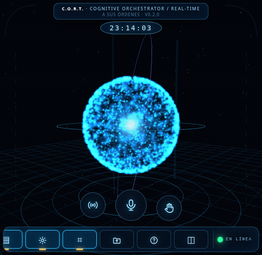
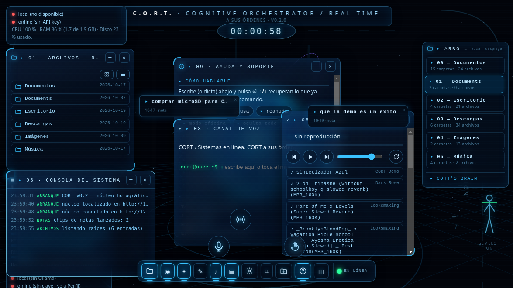

# C.O.R.T. — Cognitive Orchestrator / Real-Time

<p align="center">
  
  
  
  
  
</p>

<p align="center">
  <a href="https://github.com/Sandra2244/CORT/releases/tag/v0.2.10-demo"></a>
  <a href="https://github.com/Sandra2244/CORT/tree/v0.2-demo"></a>
  
  
  
  
  
  
  
  
</p>

Asistente personal holográfico inspirado en JARVIS (Iron Man) y Cortana (Halo):
un **orbe de partículas 3D** que escucha, responde con voz, abre tus archivos,
reproduce música y ejecuta acciones del sistema. El **cerebro es híbrido**: usa
IA local (Ollama), IA online gratuita (Groq / Gemini) o ambas, y si no hay
ninguna clave sigue siendo útil con comandos propios y modo sin conexión.





---

## Qué hace hoy (todo probado en esta rama)

| | Función | Detalle |
|---|---|---|
| 🗣 | **Voz y oído** | Micrófono y voz con la Web Speech API (gratis, sin instalar nada) + palabra de activación «Oye CORT» opcional |
| 🧠 | **Cerebro híbrido** | Enrutador `local → Groq → Gemini → modo supervivencia`; ventana **07 · Perfil** para pegar claves (se muestran en máscara) y botón que **prueba cada proveedor** con latencia en ms |
| 🌐 | **Orbe 3D** | Plexus de partículas con desenfoque de cine (bokeh real), estallido → vórtice → portal toroidal al ejecutar una orden, y anillo giratorio sincronizado con el bajo cuando suena música |
| 🪟 | **11 ventanas de vidrio** | `01 Archivos · 02 Entorno · 03 Canal de voz · 04 Notas · 05 Música · 06 Consola · 07 Perfil · 08 Cerebro · 09 Ayuda · 10 Modelos · 11 Optimizar` — arrastrables, minimizables al dock, con contadores en vivo |
| 👥 | **Modelos locales (Ollama)** | **10 · Modelos** enseña 14 modelos con su peso real, su flecha `↓ descargar` y el veredicto para **la RAM de este equipo** (`VA BIEN · JUSTO · NO CABE`): `usar`, `✕ borrar` y botón para encender o apagar Ollama. Descargar **no congela la interfaz**: el modelo pasa a la cola, Ollama se arranca solo si hace falta, la barra marca MB y MB/s reales, y cada descarga tiene su `✕ cancelar` |
| 🧹 | **Optimización del equipo** | **11 · Optimizar** contesta **al instante** con la RAM y quién se la come (con botón para cerrar procesos propios); lo que tarda —contar la caché del disco— se mide en un hilo aparte y se va pintando sola. Barre la caché segura sin tocar documentos, la papelera ni el escritorio |
| ⌨ | **Consola de comandos** | Prompt `cort@nave:~$`, historial con ↑/↓ y **Tab que completa** («repro» → «reproduce») |
| 📂 | **Archivos seguros** | Árbol lateral con doble conteo (carpetas · archivos) que se expande, vista rejilla/lista y botón **Abrir** que lanza la carpeta en el explorador del sistema |
| 🎵 | **Música** | Escanea `~/Música`, reproduce en el panel o abre tu reproductor (VLC) con «reproduce música» |
| 📝 | **Notas, pendientes y memoria** | «apunta …» guarda una nota; «tengo que comprar aceite» guarda una pendiente y «listo 1» la marca como hecha; **08 · Cerebro** muestra el muro de recuerdos enmarcados (notas + conversaciones) |
| 🔊 | **Te lo lee en voz alta** | «lee mis notas» · «lee mis tareas» · «lee el documento recibo» · «lee mis avisos». En el PC lo lee del backend (notas, pendientes y textos de tus carpetas seguras); en el teléfono `CORT-IA-1.3.0.apk` lee el **centro de notificaciones** — WhatsApp, Gmail, Telegram, Signal — con un oído que guarda doce líneas en RAM y se borran solas: nunca se escriben a disco |
| 📊 | **Sensores** | CPU / RAM / disco / batería reales y clima actual (Open-Meteo, cacheado, sin API key) |
| ✋ | **Gestos** | MediaPipe ligero: palma despliega/plega ventanas, pinza trae el chat, puño las cierra |
| 💡 | **Lámpara de estado** | Morado escuchando · naranja procesando · verde en línea · gris con el HUD oculto · rojo sin backend |
| 🖥 | **Pantallas** | Además del orbe hay tres hojas a pantalla completa: **Música** (sólo en el teléfono), **Charla** (chat normal con tus modelos de Ollama, copiar y seleccionar) y **Código** (terminal + cuaderno). Se cambia con ☰, deslizando el dedo de lado, con `Alt+←/→` o diciéndolo. Ninguna tapa el orbe: cuando no es su pantalla, el lienzo WebGL se apaga |
| 📱 | **APK del teléfono** | **Uno solo** en la Release: `CORT-IA-1.3.0.apk`, el que compila `apps/apk/compilar.sh` en GitHub Actions, con el anillo de siempre como icono, el rol de asistente, su propio reproductor, el doble toque del auricular y la lectura de avisos |
| 🎙 | **El oído no traba el teléfono** | «Oye CORT» cierra el micrófono cuando la app se va a segundo plano, cuando se apaga la pantalla, mientras suena música y mientras la ventana 11 está contando caché, y vuelve solo al pasar todo eso. Si nadie la llama, se españa cada vez más en vez de reabrir el micro cuatrocientas mil veces |
| 🤖 | **CORT como asistente** | En `CORT-IA-1.3.0.apk`: di «pon CORT como asistente» (o usa el botón `CORT · PC` ▸ «Poner CORT como asistente») y Android abre su cuadro de rol —`RoleManager`, API 29+— para elegir CORT. El gesto del asistente, la pantalla bloqueada y el doble toque del auricular quedan entonces en CORT; el «OK Google» con la pantalla apagada se pierde, porque eso lo decide el servidor de Google |
| 📡 | **Modo teléfono** | `bash scripts/telefono.sh` enlaza la Wi-Fi y el celular abre el holograma actual en `http://IP-del-PC:8000` |
| ⏻ | **Arranque BIOS** | Secuencia de encendido que comprueba en vivo cada subsistema y el puerto donde vive el núcleo |

Atajo de teclado: **Esc** oculta o devuelve todas las ventanas (deja solo el orbe).

---

## Arquitectura

```
┌───────────────── Interfaz (ui/) ─────────────────────────────────────────┐
│  Three.js: orbe de partículas + portal     11 ventanas de vidrio + dock  │
│  Web Speech: micrófono y voz                 MediaPipe: gestos (opt-in)  │
│  Auto-descubre el núcleo: localhost:8000 → 8080 → puente Android         │
└──────────────────────────┬───────────────────────────────────────────────┘
                           │  HTTP 127.0.0.1:8000  (un solo puerto)
┌──────────────────────────┴───────────────────────────────────────────────┐
│  Backend Python · FastAPI (backend/app/)                                 │
│  main.py ─ API + reparte la interfaz con CORT_SERVE_UI=1                 │
│  actions.py ─ «abre / lanza / reproduce / apunta» → acciones del sistema │
│  brain.py ─ enrutador híbrido: local → Groq → Gemini → supervivencia     │
│  models.py ─ catálogo de Ollama, veredicto de RAM y descargas en hilo    │
│  optimize.py ─ RAM en vivo, procesos pesados y caché borrable (seguro)   │
│  config_store.py ─ ajustes y claves (archivo JSON, se leen al vuelo)     │
│  sensors.py ─ archivos seguros + apertura con visor del sistema + clima  │
│  memory.py ─ SQLite (notas, conversaciones, preferencias)                │
└──────────────────────────────────────────────────────────────────────────┘
```

**Un solo proceso, un solo puerto.** Con `CORT_SERVE_UI=1` el backend reparte
también el holograma, así que `http://localhost:8000` es a la vez la interfaz y
la API: nada que configurar y ningún puerto expuesto a internet.

---

## Instalación

### 1 · Requisitos

- **Python 3.10 o más nuevo**
- **Chrome o Edge** (por el micrófono y la voz del sistema)
- Nada más: las dependencias se instalan solas en un `venv` del proyecto.

### 2 · Obtener el código

```bash
git clone -b v0.2-demo https://github.com/Sandra2244/CORT.git
```

o descarga el ZIP de esta rama (`Code ▸ Download ZIP`) y descomprime.

### 3 · Arrancar

| Sistema | Comando | Se abre en |
|---|---|---|
| **Linux / macOS** | `bash scripts/run.sh` | `http://localhost:8000` (lo abre solo) |
| **Windows** | doble clic en `scripts\run.bat` | `http://localhost:8000` |
| **Ventana holográfica (Electron)** | `bash scripts/run-desktop.sh` | ventana sin marco, modo cabina |
| **Linux, instalado como app** | `bash scripts/instalar-linux.sh` | icono en `~/Escritorio/CORT.desktop` (extrae el AppImage sin sudo) |
| **Android (APK del teléfono)** | instala [`CORT-IA-1.3.0.apk`](https://github.com/Sandra2244/CORT/releases/latest) | un solo APK: el anillo de siempre, las once ventanas, su reproductor, sus pantallas y el rol de asistente |
| **Teléfono en la misma Wi-Fi** | `bash scripts/telefono.sh` | `http://IP-de-tu-PC:8000` desde el navegador del celular |

> ¿El puerto 8000 está ocupado? `CORT_PORT=8090 bash scripts/run.sh`
> (en Windows: `set CORT_PORT=8090` antes de `scripts\run.bat`). La interfaz
> encuentra sola el puerto nuevo.

### 4 · Activar el cerebro conversacional (opcional)

Sin claves, CORT ya responde con comandos locales, clima, archivos, música y
memoria. Para conversación libre elige una de estas dos vías:

- **Desde la propia interfaz** (recomendado): abre **07 · Perfil**, pega la
  clave en `Groq` o `Gemini` y pulsa **Guardar**. Pulsa **Probar cerebro** para
  ver cuál responde más rápido. Las claves se quedan en tu equipo.
  - Groq (gratis, muy rápido): <https://console.groq.com/keys>
  - Gemini (gratis): <https://aistudio.google.com/apikey>
- **Por archivo**: copia `backend/.env.example` a `backend/.env` y rellena
  `GROQ_API_KEY` / `GEMINI_API_KEY`.

**IA local** (solo equipos con 8 GB+ de RAM): instala [Ollama](https://ollama.com),
ejecuta `ollama pull qwen2.5:3b` y CORT lo detecta solo. En equipos modestos
deja `CORT_MODE=online` o `auto`; **no** instales Ollama si tu PC tiene poca RAM.

El modo se fuerza con `CORT_MODE` (`.env`) o desde **Perfil**: `auto`, `local`,
`online`, `offline`.

### 5 · Descargas ya compiladas

[La última Release](https://github.com/Sandra2244/CORT/releases/latest) tiene los
instaladores generados por GitHub Actions (nunca se compilan en tu PC, que para
eso hace falta un equipo sobrado):

| Archivo | Para |
|---|---|
| `CORT.Setup.0.2.0.exe` | Windows 10/11 64 bits (instalador NSIS, eliges carpeta) |
| `CORT-0.2.0.AppImage` | Linux genérico (ejecutable directo) |
| `cort-desktop_0.2.0_amd64.deb` | Debian / Ubuntu / Mint |
| `CORT-IA-1.3.0.apk` | Android 8+: **el único APK**. El anillo de siempre como icono, once ventanas de vidrio, rol de asistente del sistema, reproductor propio con gustos y playlists, lectura de avisos, llamadas, y las pantallas Charla / Código / Música |
| `CORT-IA-1.3.0-firma.txt` | con qué llave salió y qué lleva dentro (prueba pública) |

> Los instaladores de escritorio abren el mismo backend de Python: siguen
> necesitando Python 3.10+ en el equipo, y la primera vez puede tardar unos
> segundos en arrancar mientras crea su entorno.

### 6 · CORT en el teléfono

Hay **un solo APK**, y es el que se compila aquí de principio a fin:

| APK | Qué es | Dónde está |
|---|---|---|
| `CORT-IA-1.3.0.apk` | Java puro sin Gradle (`aapt2` + `javac --release 11` + `d8` + `zipalign` + `apksigner`), con el holograma del repo embebido bajo `https://cort.local` y su puente de voz propio (`CortNative.java`). Lleva el **anillo de siempre** como icono —`compilar.sh` saca los cinco `mipmap-*` y el XML adaptativo del `base/CORT-IA-1.1.0.apk`, no lo dibuja nadie—, el traje de `VoiceInteractionService` para **ser el asistente predeterminado**, `MediaSession` para el **doble toque del auricular**, `Avisos` (`NotificationListenerService`) que **lee en voz alta lo que llega**, y ahora **su propio reproductor** (`.Reproductor`, un servicio en primer plano con `foregroundServiceType="mediaPlayback"`): biblioteca leída de `MediaStore`, gustos que se aprenden con 👍/👎, listas guardadas, avance/retroceso y **cuadro a cuadro** en vídeo, todo en segundo plano sin trabar el teléfono. | `apps/apk/compilar.sh` → la Release |

La vía de **rempaquetar** el binario original (`rempaquetar.sh`) está borrada del
repo y del workflow. Existía porque el proyecto Gradle que generó el `1.1.0`
nunca estuvo en este repo —lo guardado era el binario
(`instaladores/CORT-IA-1.1.0.apk`, SHA-256 `b5fa07fa…`)— y lo único que se le
podía cambiar era la cara. Ese camino daba dos APK que había que saber elegir, y
la dueña lo pidió claro: **todo dentro del que se compila**. Lo que se conserva
del binario es su icono, que es lo que lo hace «el de siempre».

Qué es verdad y qué no, dicho sin adornos:

- **El reproductor, la música y las llamadas funcionan en el teléfono sin PC**;
  las ventanas 10 · Modelos, 11 · Optimizar, la pantalla **Charla** y la
  pantalla **Código** necesitan el backend del portátil, porque piden `/api/*`.
  Sin PC no inventan una respuesta: la cara traduce el `501` del `MainActivity`
  y lo dice en voz alta. `MainActivity` intercepta `/api/*` a propósito.
- **La pantalla Código ejecuta en el PC, no en el teléfono.** Android no permite
  abrir un shell desde una app normal; por eso ese terminal manda la orden al
  núcleo (`/api/command`) y lo que ves es lo que hizo tu portátil. Prometer un
  terminal que «arregla el teléfono» sería mentira.
- **Leer los avisos pide un interruptor a mano, una vez.** Abre el menú (el botón
  `☰`) y toca «Dar el permiso de los avisos», o ve a Ajustes ▸ Notificaciones ▸
  Acceso de notificación y activa CORT. Sin él CORT no ve la barra.
- **Con CORT como asistente se pierde el «OK Google» con la pantalla apagada**,
  porque eso lo decide el servidor de Google, y Android sólo permite un asistente.
- **Contestar llamadas por ti, buzón de voz, leer SMS y gestionar el correo no
  están en este APK.** Contestar exige el rol `ROLE_CALLING` y un `InCallService`
  (quedarse con la pantalla de llamada del sistema), y para SMS/WhatsApp no hay
  API: se diría «lo hago» y no es cierto. Aquí CORT **ve con quién hablas y marca
  el número** (`Telefono.java`, con permiso de contactos y de llamar concedido a
  mano); lo demás está anotado como pendiente en `docs/PLAN-CORT.md`.
- **Actualizar el APK todavía pide desinstalar, y ya se sabe por qué.** Hasta
  `v0.2.8-demo` cada run firmaba con una llave desechable distinta, y para Android
  una firma distinta es otra aplicación; al desinstalar se va lo concedido a mano
  (micrófono, avisos, contactos, dirección del PC) y lo que CORT apuntó **en el
  teléfono**: tus gustos musicales y tus listas viven en las preferencias de la
  app. Lo que no se pierde es el cerebro: las notas, los recuerdos y las
  pendientes están en el PC (`~/.cort/`, o `%APPDATA%\CORT\` en Windows), y las
  claves de Groq/Gemini también.
  `apps/apk/llave.sh` intentó arreglarlo con la caché de Actions y **está medido
  en `v0.2.10-demo`: no basta** — `actions/cache` guarda cada llave en el
  *ref* que la creó, una etiqueta nueva es otro ref, y la huella de esta Release no
  coincide con la de `v0.2.9-demo` (`645fee97…`). Lo que sí es permanente es el
  secreto del repo, y se fabrica en tu propio PC con `bash scripts/llave-nueva.sh`:
  deja `cort-llave.b64` y `cort-llave.pass`, que se pegan como
  `CORT_APK_KEYSTORE_B64` y `CORT_APK_KEYSTORE_PASS` en Settings ▸ Secrets and
  variables ▸ Actions. **A partir de la Release que ya use ese secreto, actualizar
  vuelve a ser instalar encima.** Comprobación pública mientras tanto: la huella
  SHA-256 del certificado sale en el `-firma.txt` de cada APK y como anotación del
  check-run; dos Releases seguidas con la misma huella = la llave se mantuvo. La
  llave nunca se sube al repo (está en `.gitignore`, y el repo es público).
- **Tus claves de Groq/Gemini tampoco se pierden ya al actualizar el
  instalador.** `cort_config.json` y `cort_memory.db` (las notas, los recuerdos y
  las pendientes) vivían dentro de `backend/`, o sea dentro de la carpeta que el
  `.exe`, el AppImage o el `.deb` sustituyen. Ahora viven en la carpeta personal —
  `~/.cort/` en Linux y macOS, `%APPDATA%\CORT\` en Windows, o donde diga
  `CORT_HOME` — y la primera arrancada copia ahí lo que hubiera antes (copia, no
  movimiento: el archivo viejo se queda por si algo se tuerce). **07 · Perfil**
  muestra la ruta, para que se vea con los ojos. Lo comprobado aquí:
  `scripts/prueba-datos.py`, en un `mktemp`, sin tocar tus archivos reales.
- Nada de esto está probado con un dedo encima: en esta máquina no hay teléfono.
  Lo que sí comprueba el pipeline es que el APK rempaquetado conserva los cuatro
  `classes.dex` y los 17 archivos de `mipmap`, que `zipalign` pasa y que
  `apksigner verify` acepta la firma.
- **El `CORT-IA-1.1.1.apk` de la Release anterior (1.752.631 bytes) se comparó
  entrada por entrada contra el 1.1.0 original**, descargando los dos: entran tres archivos
  de firma (`META-INF/CORT.SF`, `.RSA`, `MANIFEST.MF`), sale uno
  (`app-metadata.properties`) y **ninguna otra entrada cambia de contenido** —
  los cuatro `classes.dex`, los siete `kotlin/*`, los 17 `mipmap` y
  `resources.arsc` son byte a byte los del APK de siempre. Los 11 archivos de
  `assets/ui/` que entran son byte a byte el `ui/` del commit. O sea: cuerpo
  original intacto, cara actualizada, icono original intacto.

El **modo teléfono sin instalar nada** sigue disponible para ver la cara actual
en el navegador del celular: `bash scripts/telefono.sh` (igual que `run.sh`, pero
enlazado a la red) y abres `http://IP-de-tu-PC:8000`. Comprado en tu equipo: la
página y `/api/models` responden por la red local (200 OK). Su límite es el
micrófono: por `http` no habla ni escucha; para eso está el APK.

Para regenerarlos con código nuevo, sube una etiqueta (el sufijo `-demo` es para
no chocar con las `v0.x` que ya usa el historial de la app de Android):

```bash
git tag -a v0.2.10-demo -m "CORT" && git push origin v0.2.10-demo   # ← dispara la compilación
```

También a mano: **Actions ▸ Construir instaladores CORT ▸ Run workflow**.

---

## API (localhost, sin autenticación porque no sale de tu equipo)

| Método y ruta | Para qué |
|---|---|
| `POST /api/chat` | `{message}` → `{reply, source}`: respuesta del cerebro |
| `POST /api/command` | `{message}` → `{reply, source, done[]}`: además **ejecuta** (abrir, lanzar, reproducir, anotar) |
| `GET /api/status` | Estado del cerebro híbrido, sistema, batería y versión |
| `GET /api/port` | En qué puerto vive este núcleo (para la auto-detección) |
| `GET · POST /api/config` | Leer/guardar cerebro y voz; las claves llegan **en máscara** |
| `GET /api/brain/test` | Prueba cada proveedor: `ok`, modelo, latencia en ms y error legible |
| `POST /api/open` | `{path}` → abre archivo o carpeta con su visor del sistema |
| `GET /api/files` · `/api/tree` | Explorador de raíces seguras y árbol con conteos |
| `GET /api/memories` | Muro de recuerdos (notas + conversaciones) |
| `GET /api/weather` | Clima actual (Open-Meteo, cacheado 20 min) |
| `GET /api/history` · `POST /api/profile` | Historial reciente y preferencias |
| `GET /api/support` | Datos de contacto y soporte que muestra la ventana **09** |
| `GET /api/models` | Catálogo de Ollama con peso real, veredicto de RAM y lo ya descargado (**10**) |
| `GET /api/models/progreso` | Avance de cada descarga en curso: MB, MB/s y porcentaje reales, sumando las capas del modelo |
| `POST /api/models/pull · /rm · /use · /ollama` | Bajar (va **a la cola**, la interfaz no se espera), borrar o elegir modelo y encender/apagar Ollama |
| `POST /api/models/cancel` | Corta una descarga o la quita de la fila |
| `GET /api/optimize` | RAM, procesos pesados, caché borrable y consejos para este equipo (**11**). Contesta **al instante** con lo que ya está medido y dice `midiendo: true` mientras la caché del disco se cuenta en un hilo aparte |
| `POST /api/optimize/clean · /kill` | Barrar caché por nivel (`seguro`, `todo`, `papelera`) o cerrar un proceso propio |

## Seguridad y privacidad

- Backend y Ollama **solo escuchan en `localhost`**; ningún puerto se expone a internet.
- Archivos: lista blanca de **raíces personales** (Documentos, Escritorio,
  Descargas, Imágenes, Música, Videos) con bloqueo de salidas por `..`.
- **Tus claves y tus notas no viven dentro del programa** sino en tu carpeta
  personal (`~/.cort`, `%APPDATA%\CORT`, o donde diga `CORT_HOME`), así que
  actualizar o reinstalar el instalador no las borra. `GET /api/config` devuelve
  una máscara (`gsk_abcde…35`), nunca la clave entera, y 07 · Perfil enseña la
  ruta donde está guardada.
- Los avisos que CORT lee en el teléfono (WhatsApp, Gmail, Telegram) **no se
  guardan**: doce líneas en RAM del proceso, se van solas y «olvida los avisos»
  las tira. La llave con la que se firma el APK tampoco está en el repo: está en
  la caché privada de Actions (el repo es público).
- **Nunca ejecuta programas por la ruta de archivos**: las extensiones de
  programa están vetadas y hay un tope de tamaño (400 MB).
- Los lanzadores usan una lista blanca estricta (`LAUNCH_ALLOWLIST`); en el
  equipo de prueba la orden «abre terminal» fue rechazada y «abre youtube» funcionó.
- Sin cuentas, sin telemetría y sin llamadas a servicios propios: lo único que
  sale del equipo es la petición a la IA que tú elijas (o ninguna, en modo offline).

## Estructura

| Ruta | Qué es |
|------|--------|
| `backend/app/main.py` | API FastAPI y servidor de la interfaz |
| `backend/app/brain.py` | Cerebro híbrido, enrutador y prueba de proveedores |
| `backend/app/actions.py` | Ejecutor de acciones del sistema (frases → hechos) |
| `backend/app/local_commands.py` | Comandos instantáneos sin IA (hora, batería, CPU…) |
| `backend/app/config_store.py` | Ajustes y claves en `backend/cort_config.json` |
| `backend/app/sensors.py` | Raíces seguras, apertura con visor y clima |
| `backend/app/memory.py` | Memoria persistente SQLite |
| `backend/app/models.py` | Catálogo de Ollama, veredicto de RAM y descargas en segundo plano |
| `backend/app/optimize.py` | RAM, procesos y cachés: lista blanca de rutas y lista negra de procesos |
| `ui/index.html` · `ui/css` · `ui/js` | Holograma: orbe Three.js + HUD + voz + gestos |
| `ui/vendor/` | Three.js incluido: la interfaz funciona sin internet |
| `desktop/main.cjs` | Ventana Electron (modo cabina / modo vidrio) |
| `apps/apk/` | El proyecto Android sin Gradle: Java puro + `compilar.sh` — el único APK que sale (asistente, avisos, reproductor propio y llamadas) —, `llave.sh` para la firma estable y `base/` con el binario viejo sólo para tomar su icono. Lo compila Actions, nunca tu PC |
| `docs/` | Plan de arquitectura, fotogramas de referencia y capturas |
| `scripts/` | `run.sh` (Linux/macOS), `run.bat` (Windows), `run-desktop.sh` (Electron), `instalar-linux.sh` (app instalada), `telefono.sh` (Wi-Fi), `prueba-lectura.py` y `prueba-costura.py` (las dos comprobaciones de esta ronda, en sandbox, sin tocar tus carpetas) |
| `.github/workflows/build.yml` | CI que compila los instaladores y publica la Release |

## Hoja de ruta

- [x] **F1** Backend híbrido + memoria SQLite + comandos locales
- [x] **F2** Orbe Three.js conectado al backend, chat y reloj
- [x] **F3** Paneles HUD, secuencia de arranque, sensores, ventanas de vidrio
- [x] **F4** Gestos con MediaPipe en modo ligero (código listo; falta probar con cámara física)
- [x] **F5** Ejecutor de acciones, música, notas, perfil con pruebas de cerebro,
      ventana de ayuda y soporte (wake word incluida; Piper TTS queda opcional
      porque Web Speech ya da voz gratis)
- [x] **F6** Escritorio Electron + instaladores por CI (.exe / .AppImage / .deb)
- [x] **F7** Android: **un solo APK** en la Release — `CORT-IA-1.3.0.apk`, que compila `apps/apk/compilar.sh` desde cero en Java y sin Gradle. Es el asistente predeterminado (rol por `RoleManager`), escucha el doble toque del auricular (`MediaSession`), lee en voz alta los avisos que llegan (`Avisos.java`, un `NotificationListenerService` que sólo guarda doce líneas en RAM), trae el anillo de siempre como icono (sacado de `base/CORT-IA-1.1.0.apk`) y lleva dentro su propio reproductor (`.Reproductor` + `Musica.java`: biblioteca, gustos, playlists y cuadro a cuadro en vídeo) y el marcador de contactos (`Telefono.java`). La vía de `rempaquetar.sh` está borrada del repo y del workflow: dos APK que había que elegir era trabajo doble y lío para instalar
- [x] **F7a** Voz que lee: «lee mis notas / mis tareas / mis avisos / el documento …» — notas y pendientes en SQLite (`memory.py`), textos de las carpetas seguras (`sensors.leer_texto`) y avisos del teléfono por la barra de notificaciones. Comprobado sin teléfono con `scripts/prueba-lectura.py` y `scripts/prueba-costura.py`
- [x] **F7c** Pantallas aparte del orbe (`ui/js/pantallas.js`): **Charla** (chat con burbujas, modelos de Ollama, copiar y guardar en Notas), **Código** (terminal contra `/api/command` + cuaderno de código) y **Música** en el teléfono. Se cambia con ☰, deslizando, `Alt+←/→` o por voz, y el orbe se apaga cuando no le toca para no gastar GPU ni batería
- [ ] F7b Contestar llamadas por ti y buzón de voz: pide el rol `ROLE_CALLING` con su `InCallService` (Android no deja otra cosa); leer SMS o el contenido de WhatsApp no tiene API, así que no se finge
- [ ] F8 Idiomas adicionales y temas visuales

Todo el software usado es gratuito.

---

## 💬 Soporte, colaboración y contacto

¿Eres programador y quieres sumar una función, un idioma o un cerebro nuevo?
¿O simplemente quieres saber cómo funciona? Escríbenos con el asunto **«CORT»**
y te contamos por dónde seguir.

| Rol | Persona | Correo |
|---|---|---|
| 👩‍ Creadora del proyecto | Sandra | [sandrasofialopezgomez3@gmail.com](mailto:sandrasofialopezgomez3@gmail.com) |
| 🤝 Colaborador | Carlos | [carlosa3325@gmail.com](mailto:carlosa3325@gmail.com) |

**Apoyar el proyecto (opcional).** C.O.R.T. es personal, abierto y sin fines de
lucro: no hay nada que vender. Si aun así quieres invitar un café o cubrir el
coste de una GPU para probar modelos locales, escríbenos a cualquiera de los dos
correos y te decimos cómo — sin compromisos y sin intermediarios.

Los errores y las ideas también bienvenidos por
[Issues](https://github.com/Sandra2244/CORT/issues).

## Licencia

[MIT](LICENSE) — úsalo, cópialo y modifícalo con citar el origen.
